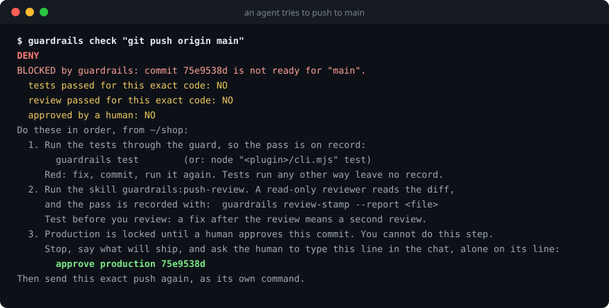

<div align="center">



**No YOLO. No slop. No echo chamber. Your agent has to prove it.**



[](https://github.com/bassemAmous/raise-the-bar/actions/workflows/test.yml)
[](LICENSE)


**[Try it](#try-it-in-60-seconds)** · **[no-yolo](#no-yolo)** · **[no-slop](#no-slop)** · **[no-echo](#no-echo)** · **[Renamed](#renamed-in-030)** · **[Why](#why-this-exists)** · **[Limits](#honest-limits)**

</div>

Three plugins for [Claude Code](https://claude.com/claude-code), 26 skills. They hold
agent-written work to the bar a senior engineer would: tested, reviewed by someone who did not
write it, and never in production without a person saying yes. The picture above is real output
of the guard, generated by `node plugins/no-yolo/scripts/demo.mjs --svg`.

## Try it in 60 seconds

```
/plugin marketplace add bassemAmous/raise-the-bar
/plugin install no-yolo@raise-the-bar
```

Then, from a clone of this repository, watch the guard refuse a push on a throwaway repository
(nothing is pushed anywhere):

```
node plugins/no-yolo/scripts/demo.mjs
```

The other two plugins install the same way:

```
/plugin install no-slop@raise-the-bar
/plugin install no-echo@raise-the-bar
```

Each plugin works alone. Needs Node.js 20 or newer and git. No other dependency.

## From idea to production

<div align="center">

</div>

`no-echo` helps decide what to build. `no-slop` shapes how it is built. `no-yolo` checks what is
about to ship. Use one, or all three.

And when it is time to present the thing: [`story-or-snore`](plugins/no-echo/skills/story-or-snore)
turns the pitch into a story people stay awake for. Content or fun is a false choice. The story
carries the content, part by part, and a script checks that it still does.

## The three plugins

### no-yolo

**The rules an agent cannot talk its way past.** Hooks that run before the agent's commands.
They do not ask the agent to behave; they check.

| Rule | What it stops |
| --- | --- |
| Secret scan | A commit that adds an API key, a private key, a password in a URL, or a `.env` file |
| Tests on record | A push to a protected branch when the tests did not pass on that exact code, or when no test command is set at all |
| Review on record | A push to a protected branch with no passed review of that exact code |
| Production lock | A push or deploy to production until a human approves that one commit |
| Forward-only history | Force-push to, or deletion of, a protected branch |
| Danger guard | `rm -rf` on root, home or `.git`, `--no-verify`, drop database, delete without a filter |
| Self-protection | The agent approving its own work, writing into the record folder, or quietly editing the rules |
| Second check by git | A push the command reader could not see. With `guardrails install-hook`, git's own pre-push hook asks again, with the commit and the branch it really sends |

| Skill | What it does |
| --- | --- |
| [`you-shall-not-push`](plugins/no-yolo/skills/you-shall-not-push) | Gets a commit past the guard: tests on record, a review by an agent that did not write it, then a human for production |
| [`done-done`](plugins/no-yolo/skills/done-done) | Checks work against evidence before anyone says "done": what is proven, what is not, what was not checked |
| [`who-let-you-in`](plugins/no-yolo/skills/who-let-you-in) | Read-only security audit: who can reach what, each finding attacked by a second agent before it counts |
| [`mind-the-headers`](plugins/no-yolo/skills/mind-the-headers) | Read-only check of the security headers and cookie flags a live site really sends |

[Read more](plugins/no-yolo/README.md)

### no-slop

**How the work gets done.** Seventeen skills for everyday engineering, and a reviewer agent that
can only read.

| Skill | What it does |
| --- | --- |
| [`idea-to-ta-da`](plugins/no-slop/skills/idea-to-ta-da) | Builds a feature from a rough idea: brief, plan reviewed before code, smallest version, proof it works |
| [`you-had-one-job`](plugins/no-slop/skills/you-had-one-job) | Checks the work does all of the ticket and only the ticket, clause by clause, with proof |
| [`show-me-red`](plugins/no-slop/skills/show-me-red) | Proves each test can fail: breaks what it checks and records that it goes red |
| [`most-wanted-bugs`](plugins/no-slop/skills/most-wanted-bugs) | Hunts bugs in rounds; a skeptic tries to disprove each one; fixes proven red then green |
| [`spaghetti-meter`](plugins/no-slop/skills/spaghetti-meter) | Grades code readability out of 10 with a ranked fix list, or applies the fixes |
| [`find-the-snail`](plugins/no-slop/skills/find-the-snail) | Finds why something is slow by measuring first, then ranks fixes by gain. Read-only |
| [`pixel-police`](plugins/no-slop/skills/pixel-police) | Reviews real screenshots at phone and desktop width, not just the code |
| [`main-is-lava`](plugins/no-slop/skills/main-is-lava) | Does every multi-file change in its own git worktree, so the main checkout stays clean |
| [`not-another-wip`](plugins/no-slop/skills/not-another-wip) | Writes commit messages and pull request text a teammate understands on first read |
| [`message-in-a-bottle`](plugins/no-slop/skills/message-in-a-bottle) | Writes a handoff note another session can pick up cold, with a start check it runs first |
| [`homework-for-humans`](plugins/no-slop/skills/homework-for-humans) | Writes tick-box test cards for a person who tests by hand |
| [`no-comment`](plugins/no-slop/skills/no-comment) | Keeps code comments that say why, never what |
| [`no-great-question`](plugins/no-slop/skills/no-great-question) | Makes replies plain: answer first, short sentences, no filler |
| [`lost-in-translation`](plugins/no-slop/skills/lost-in-translation) | Finds text that is missing or untranslated in any supported language |
| [`bug-autopsy`](plugins/no-slop/skills/bug-autopsy) | Saves the lesson of a fix, or of a mistake, where the next session will read it |
| [`future-me-problem`](plugins/no-slop/skills/future-me-problem) | Writes deferred work down so someone with no context can pick it up |
| [`skill-issue`](plugins/no-slop/skills/skill-issue) | Improves a skill from how it really ran, keeping its size flat or smaller |

[Read more](plugins/no-slop/README.md)

### no-echo

**Decisions with the disagreement left in.** Opposed viewpoints argue the same question and the
dissent stays in the answer. The seats are roles, not imitations of real people, and every number
is traced to a source or marked as assumed. The fifth skill tells the decision to a room.

| Skill | What it does |
| --- | --- |
| [`but-should-we`](plugins/no-echo/skills/but-should-we) | A quick "should we": a few questions, six checks, one recommendation, the cheapest test |
| [`let-them-fight`](plugins/no-echo/skills/let-them-fight) | One weighty business or product decision, argued by opposed seats over rounds, scored |
| [`rewrite-or-regret`](plugins/no-echo/skills/rewrite-or-regret) | A costly technical fork (a rewrite, a datastore, a migration) argued by five engineering seats |
| [`what-could-go-wrong`](plugins/no-echo/skills/what-could-go-wrong) | Finds how a plan you already chose fails, and what to fix first |
| [`story-or-snore`](plugins/no-echo/skills/story-or-snore) | Turns a pitch or talk into a story people stay awake for: 4 to 6 options mapped part by part to the product, you pick, then a timed script a check can fail |

[Read more](plugins/no-echo/README.md)

## Renamed in 0.3.0

If you used 0.2: the plugins and skills have new names, and the old slash commands no longer
work. Uninstall each plugin under its old name and install it under the new one, for example:

```
/plugin uninstall guardrails@raise-the-bar
/plugin install no-yolo@raise-the-bar
```

The guard keeps its own name: the `guardrails` command, `guardrails.config.json`, the
`BLOCKED by guardrails` messages and the `guardrails:allow-secret` mark are unchanged, so existing
setups keep working. Each skill still answers to its old name in plain words.

| Old name | New name |
| --- | --- |
| plugin `guardrails` | plugin `no-yolo` |
| plugin `craft` | plugin `no-slop` |
| plugin `council` | plugin `no-echo` |
| `/guardrails:done-check` | `/no-yolo:done-done` |
| `/guardrails:push-review` | `/no-yolo:you-shall-not-push` |
| `/guardrails:readonly-audit` | `/no-yolo:who-let-you-in` |
| `/craft:build-it` | `/no-slop:idea-to-ta-da` |
| `/craft:clean-code` | `/no-slop:spaghetti-meter` |
| `/craft:performance` | `/no-slop:find-the-snail` |
| `/craft:bug-hunt` | `/no-slop:most-wanted-bugs` |
| `/craft:ux-review` | `/no-slop:pixel-police` |
| `/craft:worktree-first` | `/no-slop:main-is-lava` |
| `/craft:bug-retro` | `/no-slop:bug-autopsy` |
| `/craft:later` | `/no-slop:future-me-problem` |
| `/council:strategy` | `/no-echo:but-should-we` |
| `/council:boardroom` | `/no-echo:let-them-fight` |
| `/council:senior-council` | `/no-echo:rewrite-or-regret` |
| `/council:red-team` | `/no-echo:what-could-go-wrong` |

The other eleven skills are new in 0.3.0.

## Why this exists

An agent that writes code is fast and confident. Both are a risk on the day it is wrong. Three
ideas run through everything here:

1. **Evidence, not claims.** "Done" needs something a person can look at. A test pass is recorded
   by the tool that ran it, for the exact content of the commit, and one more commit voids it.
2. **The author does not review.** Reviews are done by a separate agent whose write tools are
   removed, not by the session that wrote the code.
3. **A person decides production.** The approval names one commit, expires, and is read from what
   the human typed. The agent cannot produce it.

Generalised from the setup behind a production web and mobile app, rewritten to be driven by one
config file with no project-specific rules.

## Honest limits

- **Hooks are guardrails, not a sandbox.** They stop mistakes and shortcuts. An agent that sets
  out to defeat them on a machine it controls can find a way. Keep the server-side protections:
  branch protection, required reviews, deploy permissions.
- The hook judges a command before it runs. So a push to a protected branch has to be sent as
  its own command, not chained after the commit that creates the code, and a commit is not
  chained after a step that writes files. The guard says so, and says what to send instead.
- Reading a command line is best effort. The second check (git's own pre-push hook, added with
  one command) sees the push whatever the line looked like. A merge made on the server passes
  through neither.
- A test pass is recorded by the tool that ran the tests. A review pass is recorded from a report
  the agent hands in, kept for a person to read. Both are plain files on the machine, not
  signatures.
- The secret scan knows common key formats. It is not a replacement for a full scanner in CI.
- Skills are instructions a model follows. They raise the floor; they do not guarantee a result.

## Development

```
node --test plugins/no-yolo/tests/guardrails.test.mjs      # 49 tests on real temporary git repositories
node --test plugins/no-echo/skills/let-them-fight/scripts/check-numbers.test.mjs
node --test plugins/no-echo/skills/story-or-snore/scripts/check-story.test.mjs
node --test plugins/no-slop/skills/show-me-red/scripts/scripts.test.mjs
node scripts/check-repo.mjs                                    # skill descriptions, versions, the marketplace file
claude plugin validate .                                       # the marketplace file
claude plugin validate plugins/no-yolo                         # each plugin
```

A change to a plugin needs a new `version` in its `plugin.json`. Without one, people who already
installed the plugin keep the old copy. CI checks this on every pull request. See
[CHANGELOG.md](CHANGELOG.md).

## Acknowledgements

The scored-council format in `no-echo:let-them-fight` builds on ideas from
[nateherkai/roast-room](https://github.com/nateherkai/roast-room) (MIT). The text, the seats and
the code here are written from scratch.

## License

MIT
